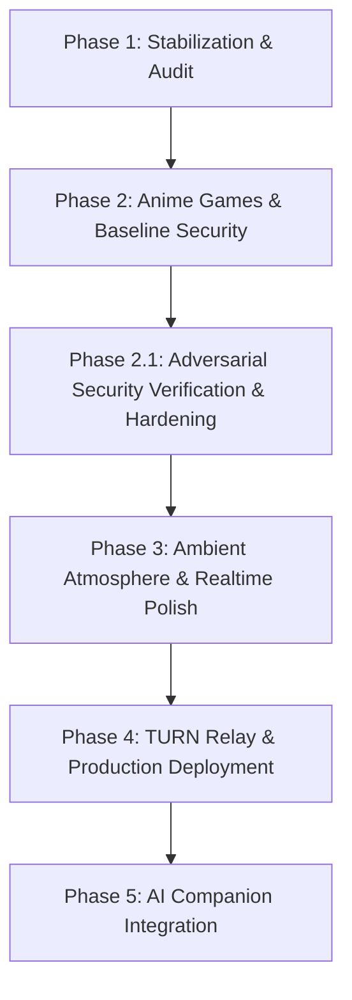

# Anime Together — Development Roadmap

**Date:** November 21, 2026  
**Auditor / Lead:** Antigravity Lead Full-Stack Engineering  
**Version:** 0.3.0 (Phase 2.1 Complete: Adversarial Hardening & Cryptographic Signatures)

---

## 1. Roadmap Overview & Milestones

---

## Phase 1: Stabilization & Audit (COMPLETED)
- [x] Full codebase audit and dependency installation.
- [x] Fix `import.meta.env` crash in test / non-Vite environments (`src/lib/env.ts`).
- [x] Fix WebRTC ICE candidate race condition by buffering pre-remoteDescription candidates (`src/media/mediaManager.ts`).
- [x] Fix duplicate peer teardown in `MediaManager.setPeers`.
- [x] Build automated two-tab integration test suite (`scripts/local-two-tabs-test.ts`).
- [x] Author comprehensive project documentation (`PROJECT_AUDIT.md`, `FEATURE_STATUS.md`, `TECHNICAL_DEBT.md`, `TEST_RESULTS.md`, `DEVELOPMENT_ROADMAP.md`).

---

## Phase 2: Anime Games & Initial Security (COMPLETED)
- [x] **Host Authorization & Anti-Spoofing Baseline:**
  - Implemented SHA-256 cryptographic host token verification (`src/lib/security.ts`).
  - Added backend-authoritative RPCs (`set_host_only`, `register_host_token`, `update_playback`).
  - Rejection of forged `payload.from` playback events without authentic host token.
  - Authored automated baseline security tests (`scripts/security-test.ts`).
- [x] **Anime Bingo Feature:**
  - Authored original 80-trope library across 8 genres (`src/lib/bingoTropes.ts`).
  - Implemented 5x5 board generator with Mulberry32 deterministic seeding and center Free Space.
  - Implemented 12-line win detection (5 rows, 5 cols, 2 diagonals) and multi-bingo counter (`src/hooks/useBingo.ts`).
  - Implemented Cooperative (shared) and Competitive (isolated) game modes.
  - Authored responsive UI with interactive stamps and victory celebrations (`src/components/BingoPanel.tsx`).
- [x] **Episode Predictions Feature:**
  - Implemented prediction creation, multi-choice/text options, timestamps, and spoiler tags.
  - Implemented submission lifecycle: submit, edit before lock, lock-in, synchronized reveal, and resolution.
  - Enforced answer privacy: other participants' answers are strictly masked (`🔒 Submitted`) before reveal in both code and PostgreSQL RLS.
  - Implemented room scoreboard with points rewards and leaderboard (`src/hooks/usePredictions.ts`, `src/components/PredictionPanel.tsx`).
- [x] **Room Interface Integration:**
  - Added dedicated "Games" tab in `src/pages/RoomPage.tsx` with sub-tab navigation (`src/components/GamesPanel.tsx`).

---

## Phase 2.1: Adversarial Security Verification & Hardening (COMPLETED)
- [x] **Adversarial Audit & Risk Identification:**
  - Uncovered broadcast secret transmission vulnerability (raw token was broadcast over wire).
  - Uncovered replay window risk (static token lacked signature binding, nonces, and timestamps).
  - Uncovered database validation gaps: unearned bingo win claims, competitive board theft, double resolution score inflation, and SQL null evaluation subtleties.
- [x] **Asymmetric Cryptography Architecture:**
  - Implemented ECDSA P-256 with SHA-256 digital signatures via Web Crypto API (`src/lib/security.ts`).
  - Zero-secret broadcast architecture: host private key stays in host session memory and is never broadcast.
  - Canonical message serialization for deterministic signature generation across all playback intents.
- [x] **Anti-Replay & Freshness Controls:**
  - Implemented 8-byte cryptographically random nonces and 15-second TTL in-memory cache to reject duplicate replays.
  - Implemented 5-second clock drift freshness window to reject stale or future-dated messages.
- [x] **Database & SQL RPC Hardening (`supabase/schema.sql`):**
  - Added `register_host_pubkey(p_room, p_pubkey)`.
  - Added `public.has_bingo_line(p_board)` helper authoritatively validating all 12 lines in PostgreSQL before awarding points.
  - Added competitive board ownership verification to prevent board theft.
  - Added `for update` row locks and resolution state guards to prevent double-scoring in predictions.
  - Enforced post-lock immutability on prediction answers and room expiry checks across all RPCs.
- [x] **Local Demo Store Hardening:**
  - Ported identical line checks, ownership checks, and double-resolution guards into `LocalGamesStore`.
- [x] **Adversarial Test Suite (`scripts/adversarial-security-test.ts`):**
  - Authored 28 automated attack scenarios verifying zero-secret exposure, replay rejection, parameter tamper detection, unearned win rejection, prediction privacy, and privilege isolation.
- [x] **Full Verification & Deliverables:**
  - Authored comprehensive report: `SECURITY_REVIEW.md`.
  - All 6 test suites passing cleanly (95/95 checks).
  - Clean production build with zero warnings.

---

## Phase 3: Ambient Atmosphere & Realtime Polish (RECOMMENDED NEXT STEP)
- **Goal:** Elevate visual immersion and modernize data subscriptions.
- **Tasks:**
  1. **Dynamic Stage Backglow:** Sample video frames or stage theme to project warm, ambient lantern backlighting behind the stage viewport.
  2. **In-Room Sakura Drift Toggle:** Provide an ambient button in the room header that gently drifts cherry blossom petals across the screen during quiet scenes.
  3. **Japanese Audio Cues:** Add subtle sound effects (e.g. wooden clapper *hyoshigi* or wind chime *furin*) on countdown completion, prediction lock, and bingo wins.
  4. **Supabase Realtime Table Changes:** Upgrade `LiveStore` and `LiveGamesStore` to subscribe directly to `postgres_changes` on Supabase tables for zero-latency database-driven updates.

---

## Phase 4: TURN Relay & Production Deployment
- **Goal:** Enable bulletproof multi-device WebRTC across cellular networks and strict firewalls.
- **Tasks:**
  1. Integrate coturn or Cloudflare Calls / Twilio Network Traversal credentials.
  2. Test multi-device WebRTC across distinct network topologies (Wi-Fi to 5G).
  3. Finalize production environment configuration scripts.

---

## Phase 5: AI Anime Companion Integration
- **Goal:** Activate the AI companion integration boundary in `src/ai/companion.ts`.
- **Tasks:**
  1. Deploy a Supabase Edge Function proxying Gemini 2.0 API with server-side API key protection.
  2. Connect video progress context to guarantee zero-spoiler responses.
  3. Add quick-action prompts ("Character analysis", "Episode recap", "Anime trivia") to the room interface.
