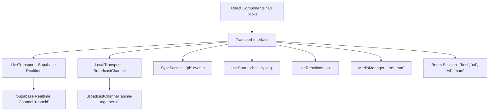

# Anime Together — Project Architecture & System Audit

**Date:** November 21, 2026  
**Auditor:** Antigravity Lead Full-Stack Engineering  
**Codebase:** React 18, TypeScript 5, Vite 5, Tailwind CSS, Supabase Realtime, WebRTC, Framer Motion

---

## 1. Executive Summary

**Anime Together** is a private, invitation-based anime watch-party web platform designed for cozy, synchronized viewing among friends. The project features a dual-runtime model:
1. **Local Demo Mode:** Operates zero-config in modern browsers using `BroadcastChannel` for signaling and presence, and `localStorage` for room state and metadata persistence.
2. **Live Production Mode:** Connects to Supabase Postgres RPCs (for authoritative room lifecycle, membership, capacity, and expiration), Supabase Realtime (with private broadcast and presence channels), and Row-Level Security (RLS) for watchlist items and saved moments.

The existing implementation provides solid architectural foundations, particularly around playback sync and separation of concerns. However, critical gaps exist: **Anime Bingo** and **Episode Predictions** are completely unimplemented; **WebRTC** lacked ICE candidate buffering during out-of-order signaling; client-side playback authorization is vulnerable to broadcast spoofing; and multi-device WebRTC requires TURN infrastructure not yet configured in demo environments.

---

## 2. Architecture Map & Directory Structure

```
anime-together/
├── src/
│   ├── ai/
│   │   └── companion.ts          # Interface stub for AI companion (no model wired)
│   ├── components/
│   │   ├── Avatar.tsx            # SVG/Emoji avatar rendering
│   │   ├── Chat.tsx              # Chat stream, spoiler toggles, discussion prompts
│   │   ├── ControlBar.tsx        # Video player controls, seek bar, sync status
│   │   ├── ErrorBoundary.tsx     # Global React error boundary
│   │   ├── MediaDock.tsx         # WebRTC toggle buttons, remote video tiles, remote audio
│   │   ├── ModeBadge.tsx         # Live Supabase vs Local Demo indicator badge
│   │   ├── Overlays.tsx          # Fullscreen toasts, floating emoji, cinematic FX scenes
│   │   ├── Panels.tsx            # Side tabs: Watchlist, Saved Moments, Room settings
│   │   ├── ReactionBar.tsx       # 10 preset emoji quick-reaction bar
│   │   ├── SourceForm.tsx        # MP4/HLS URL input & local file selector
│   │   └── Stage.tsx             # Main theater stage, video viewport, screen share viewport
│   ├── hooks/
│   │   ├── useChat.ts            # Chat history, typing indicator, rate limiting, toasts
│   │   ├── useFullscreen.ts      # HTML5 Fullscreen API wrapper
│   │   ├── useReactions.ts       # Reaction broadcast, floating particles, FX triggers
│   │   ├── useRoomSession.ts     # Core room coordinator: transport, sync, media, heartbeat
│   │   ├── useRoomStore.ts       # Watchlist & moments reactive hook
│   │   └── useVideoElement.ts    # <video> element ref, HLS.js attachment, PlayerAdapter
│   ├── lib/
│   │   ├── avatar.ts             # Avatar emoji palette & color presets
│   │   ├── env.ts                # Environment variable reader with Node/browser fallbacks
│   │   ├── ids.ts                # Cryptographic 20-char Base32 room IDs (100 bits entropy)
│   │   ├── storage.ts            # LocalStorage persistence for profile, history, preferences
│   │   └── types.ts              # Core TypeScript data contracts
│   ├── media/
│   │   └── mediaManager.ts       # Full-mesh WebRTC manager (mic, webcam, screen share)
│   ├── pages/
│   │   ├── Landing.tsx           # Torii gate hero, feature showcase, room entry points
│   │   ├── Lobby.tsx             # Profile creation, avatar customizer, room creator/joiner
│   │   └── RoomPage.tsx          # Unified watch party room view & layout manager
│   ├── realtime/
│   │   ├── createTransport.ts    # Factory for LiveTransport vs LocalTransport
│   │   ├── liveTransport.ts      # Supabase Realtime (Broadcast + Presence)
│   │   ├── localTransport.ts     # Web BroadcastChannel (local multi-tab demo)
│   │   ├── roomApi.ts            # Room lifecycle API (Postgres RPCs / LocalStorage)
│   │   ├── supabase.ts           # Supabase client singleton
│   │   └── transport.ts          # Abstract base transport contract & metadata sanitizers
│   └── services/
│       ├── roomStore.ts          # Watchlist & moments store (Supabase tables / LocalStorage)
│       └── syncService.ts        # Drift-correcting playback synchronization engine
├── scripts/
│   ├── local-two-tabs-test.ts    # Automated two-tab simulation test
│   └── sync-selftest.ts          # Playback synchronization unit test
└── supabase/
    └── schema.sql                # PostgreSQL tables, RLS policies, and RPC definitions
```

---

## 3. Room Creation & Joining Workflow

### 3.1 Live Mode (Supabase)
1. **User Identity:** `ensureUser()` checks existing session or issues an anonymous session via `sb.auth.signInAnonymously()`.
2. **Room Creation:** Calls Postgres RPC `create_room(p_nickname)`:
   - Generates a cryptographically random 20-character string from a 32-character alphabet (`[a-z2-7]{20}`, 100 bits of entropy).
   - Inserts into `public.rooms` with `host_id = auth.uid()`, `max_participants = 6`, and `expires_at = now() + interval '24 hours'`.
   - Inserts host into `public.room_members`.
3. **Room Joining:** Calls Postgres RPC `join_room(p_room, p_nickname)`:
   - Validates room exists and is unexpired (`expires_at > now()`).
   - Counts active members (`last_seen > now() - interval '60 seconds'`). Rejects with `'Room is full'` if at capacity.
   - Upserts member record in `public.room_members`.
4. **Heartbeats & Auto-Reassignment:**
   - Client sends heartbeat every 10s via `api.heartbeat(roomId)`.
   - If host fails to send heartbeats for > 30s, the oldest active peer (`list[0]`) claims host via `api.claimHost(roomId)`.

### 3.2 Local Demo Mode
1. **User Identity:** Stored in `sessionStorage` (`at_demo_uid`).
2. **Room Creation:** Generates a 20-char ID via `randomRoomId()`, stores in `localStorage['at_demo_rooms']` with 24-hour expiration.
3. **Room Joining:** Reads from `localStorage`. Throws a descriptive error if accessed from a separate browser profile without Supabase configured.
4. **Host Transfers:** Synchronously updates `at_demo_rooms` in `localStorage`.

---

## 4. Realtime Communication Architecture



The system uses a multiplexed message pattern where one underlying channel carries all sub-protocols via typed payloads:
- `pb`: Playback synchronization intents (`play`, `pause`, `seek`, `source`, `req`, `state`).
- `chat`: Chat messages (`id`, `text`, `spoiler`, `kind`).
- `typing`: Ephemeral typing beacons (auto-cleared after 3s).
- `rx`: Emoji reactions (`emoji`).
- `cd`: 3-2-1 synchronized play countdown.
- `wl`: Invalidation ping for shared watchlist updates.
- `mom`: Invalidation ping for saved moment updates.
- `host`: Host re-assignment notification.
- `rtc`: WebRTC signaling (`to`, `description`, `candidate`).
- `mm`: MediaManager active stream declarations (`streams: Record<streamId, kind>`).

---

## 5. Playback Synchronization (`SyncService`)

The synchronization engine is completely decoupled from React and follows an **echo-prevention-by-construction** architecture:
- **Local User Action:** Clicking play, pause, or seek applies the action to the local HTML5 `<video>` element via `PlayerAdapter` and broadcasts the intent to the transport.
- **Remote Action Received:** When a remote command is received, it is applied directly to the `PlayerAdapter` without re-broadcasting, preventing infinite feedback loops.
- **Drift Correction (`DRIFT_SEEK = 1.2s`):**
  - Host broadcasts its authoritative position and state every 3,000ms (`TICK_MS`).
  - Guests compare local `currentTime()` with host `time`.
  - If drift is within 1.2s, the video continues smoothly without interruption.
  - If drift exceeds 1.2s (or > 0.3s while paused), a hard seek is executed to re-align.
- **Late Joiners:** A newly connected peer emits `{ op: 'req' }`, prompting the host to immediately respond with the full `{ op: 'state', source, playing, time, hostOnly }`.
- **Autoplay Handling:** Browsers restricting audio playback trigger `NotAllowedError`. `SyncService` captures this, sets status to `'needs-interaction'`, and displays a "Tap to join playback" banner.

---

## 6. WebRTC Media Architecture

- **Topology:** Full-mesh P2P (`RTCPeerConnection` between each pair of peers).
- **Negotiation:** Implements the W3C "perfect negotiation" pattern. The tie-breaker `polite = this.t.clientId < id` determines collision resolution.
- **Stream Multiplexing:**
  - Microphones, webcams, and screen sharing exist as independent `MediaStream` objects.
  - Senders are tracked in a `Map<MediaKind, RTCRtpSender[]>`.
  - Stream kinds are advertised over the transport via `mm` events.
  - An `orphans` map handles the race condition where `pc.ontrack` fires before the `mm` metadata arrives.
- **Screen Sharing:**
  - Employs `navigator.mediaDevices.getDisplayMedia`.
  - Automatically captures system audio when supported.
  - Detects native OS/browser "Stop Sharing" bars via track `ended` events.

---

## 7. Security Architecture & Threat Model

| Security Layer | Enforced By | Mechanism / Policy | Security Guarantee |
|---|---|---|---|
| **Room Creation** | Backend (Postgres RPC) | `create_room` checks `auth.uid()` | Unauthenticated users cannot create rooms in Live mode. |
| **Room Capacity** | Backend (Postgres RPC) | `join_room` checks active member count | Maximum participant cap (6) is strictly enforced server-side. |
| **Room Expiration** | Backend (Postgres RLS/RPC) | `expires_at > now()` check on RPCs & `is_member` | Expired rooms cannot be accessed or joined. |
| **Host Assignment & Transfer** | Backend (Postgres RPC) | `transfer_host` validates `r.host_id = auth.uid()` | Only the legitimate host can transfer ownership. |
| **Host Timeout Claiming** | Backend (Postgres RPC) | `claim_host` validates host inactive > 30s | Unauthorized host takeovers are rejected by the database. |
| **Watchlist / Moments CRUD** | Backend (Postgres RLS) | `room_members` join validation | Non-members cannot read, write, or delete room items. |
| **Private Realtime Channels** | Backend (Supabase RLS) | RLS on `realtime.messages` checking membership | Non-members cannot subscribe or publish to `room:id`. |
| **Playback Control (Host-Only)** | **Client-side only** | `SyncService.isAuthorized(from)` | **Vulnerable to spoofing**: rogue client can broadcast `pb` packets. |
| **Broadcast Sender Identity** | **Client-side only** | `payload.from` in `LiveTransport` | **Vulnerable to spoofing**: rogue client can fake `from: hostClientId`. |

---

## 8. Japanese-Inspired Visual Identity & Aesthetic Audit

- **Palette:** Built with custom Tailwind tokens:
  - `sakura` (#f4a6c0, #ee80a6, #c8344b) for romantic accents and alerts.
  - `lantern` (#ffc47a, #ffb86b, #ffd793) for warm ambient glows and highlights.
  - `wisteria` (#cbb8ff) for discussion prompts.
  - `ink` (#0e0914, #1a1024, #241634) for deep night backgrounds.
- **Landing Page Hero:** Custom inline vector artwork featuring a crimson torii gate, glowing stone lanterns, large glowing harvest moon, and animated falling sakura petals.
- **Ambient Gaps:** The room view currently defaults to a pure black stage background without customizable atmospheric backlighting or toggleable ambient cherry blossom drifts.
